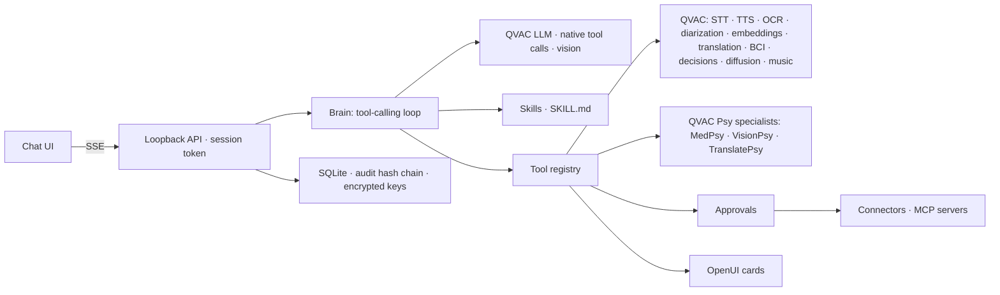

# QVAC UI

**A private AI copilot that runs entirely on your computer.** One local brain listens, reads, sees, speaks, translates, searches your files, follows skills, runs flows and uses the services you connect. It's built on the [QVAC SDK](https://qvac.tether.io), with answers shown as [OpenUI](https://github.com/thesysdev/openui) cards.

No cloud model, no API bill, no data leaving the machine unless you turn on a connector. Works offline.

> Independent open-source project. Not affiliated with, endorsed by or sponsored by Tether or Thesys.

## What it does

Everything happens in one chat. The brain picks the right tool, or you can force one with a `/command`.

| Workspace | What you get | Local models used |
|---|---|---|
| **Meeting notes** | Who spoke, a summary, decisions, action items with owners and due dates, open questions, and a Markdown copy | Sortformer speaker diarization, Whisper small, the brain |
| **Document intake** | Vendor, dates, totals and line items from invoices, receipts, PDFs and Word files, with arithmetic checks and a CSV copy | Vision brain or EasyOCR |
| **Spreadsheet analyst** | Exact totals and breakdowns as tables and charts (calculated in code, not guessed) | — |
| **Talk hands-free** | A spoken conversation: it listens, answers and speaks back | Whisper, the brain, Supertonic TTS |
| **Private vault** | Search by meaning across every file, transcript and scan you've added | EmbeddingGemma |
| **Translate** | On-device translation between English and 15 languages, plus 19 African languages | Bergamot, QVAC TranslatePsy |
| **Look at images** | Describe photos, screenshots and charts; write alt text | Qwen3.5 vision or QVAC VisionPsy |
| **Medical questions** | Educational answers from a specialist medical model | QVAC MedPsy |
| **Brain signals** | Decode public BCI research recordings into text and speak them | BCI Whisper |
| **Research** | Wikipedia, weather, Hacker News, and any service you connect | — |
| **Create** | Images and short music tracks (models download on request) | FLUX.2 klein, ACE-Step |

Plus:

- **34 skills** in the open [Agent Skills](https://agentskills.io) format (`SKILL.md`), e.g. meeting-minutes, invoice-check, daily-briefing, research-brief. The brain loads them on demand. You can write your own or paste in skills from public libraries.
- **22 connectors** that need only an API key or OAuth client ID:
  - **Work & docs:** Google Workspace (Gmail, Calendar, Drive), Microsoft 365, Notion, Slack
  - **Dev & projects:** GitHub, Linear, Jira, GitLab, Sentry
  - **Business & data:** HubSpot, Salesforce, Stripe, Airtable, Shopify, Postgres
  - **Search & web:** Brave, Tavily, Exa, Firecrawl, Wikipedia, weather, Hacker News

  Connector tools stay hidden until the brain searches for them (QVAC's deferred tool loading), so even a 4B model handles dozens of them.
- **MCP:** connect any Model Context Protocol server (local command or HTTP).
- **Flows:** reusable pipelines (e.g. recording → notes → spoken summary) that the brain can create from a sentence.
- **Approvals:** anything that sends, creates or changes data outside your computer pauses for a one-time approval of the exact arguments.

## Quick start

Requirements: Node.js 22.13+ and about 8 GB of free disk space for the recommended models. Developed and tested natively on macOS with Apple Silicon (Metal). Linux runs the test suite in CI; native inference there is untested.

```bash
git clone https://github.com/Suryanandx/qvac-ui.git
cd qvac-ui
npm ci
npm run build
npm start
```

Open the printed `http://127.0.0.1:4317/#…` link (the part after `#` is your private session key). Then go to **Settings → Models → Install recommended**. That downloads the vision brain, speech, OCR, TTS, speaker labels and vault models (about 4 GB) from the QVAC registry, each verified by SHA-256. Pick a workspace on the home screen and go.

On macOS you can also double-click **Launch QVAC UI.command**. `npm run desktop` opens the same app in an Electron window. To set up from the terminal instead, run `npm run setup:workspace` (with the app stopped). `npm run download:models -- --list` shows every catalog model and whether it's installed.

## How it works



- **One brain:** a local LLM with QVAC's native tool calling (Qwen3.5 4B with vision by default; Qwen3.5 9B, Hermes 3/4 or any GGUF). It plans, calls tools, reads results and answers.
- **Guard rails for small models:** schema-validated arguments, deduplicated calls, a bounded loop, and a rule that stops the model from "speaking" a result before it exists.
- **Cards, not code:** tool results are turned into OpenUI components on the server from validated data. Model output is never executed or rendered as HTML.
- **Memory:** follow-up questions see earlier tool results (bounded), and every document joins the private vault.

See [docs/HARNESS.md](docs/HARNESS.md) for the turn loop and API, and [docs/CAPABILITIES.md](docs/CAPABILITIES.md) for model formats and limits.

## Verification

- `npm test`: contract tests (brain loop, tools, connectors with fake HTTP, OAuth/PKCE, approvals, skills, offline mode, OpenUI serialization, API security). Needs no model weights; this is what CI runs.
- `npm run test:native-harness`: 19 end-to-end scenarios against the real local models through the HTTP API, covering every workspace, skills, flows, connectors, MCP approvals and offline mode. Results: [verification/native-harness.json](verification/native-harness.json).
- `node scripts/test-generation.mjs`: image and music generation with temporary weights that are deleted afterwards. Results: [verification/native-generation.json](verification/native-generation.json).

These check that each pipeline works, not how accurate the models are. Small local models can misread intent or make mistakes; cards always show what was actually computed. OCR can misread small glyphs. BCI decoding works only on the bundled research recordings and is not medical.

## Privacy and security

Local by default, offline mode switch, encrypted connector keys (Keychain on macOS), single-use approvals, audit log. Chats and files are stored unencrypted in a permission-restricted folder, so use full-disk encryption. Details: [SECURITY.md](SECURITY.md).

## Contributing

New skills, connectors, models and card components are all small, self-contained changes. See [CONTRIBUTING.md](CONTRIBUTING.md).

## License

Apache-2.0 (see [LICENSE](LICENSE) and [NOTICE](NOTICE)). Models have their own licenses, shown in Settings → Models. `fixtures/bci/` holds public research recordings whose redistribution terms are unverified; see [its README](fixtures/bci/README.md).
